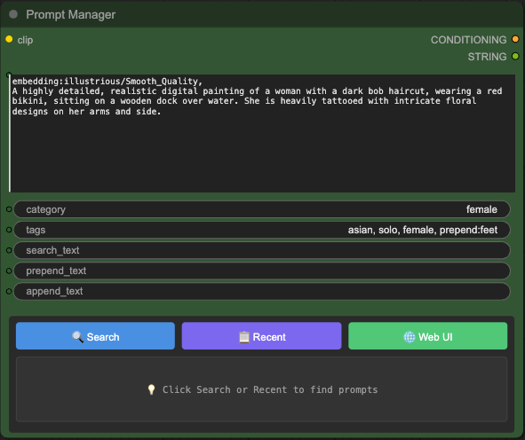

# PromptManager

A standalone prompt library and image gallery for AI-generated images, backed by SQLite.

Point it at the folders your image generator writes to. PromptManager watches them, reads the prompt and workflow embedded in every image, and builds a searchable library of prompts linked to the images they produced — with tagging, ratings, AI auto-tagging, duplicate cleanup, and a metadata viewer. It runs as its own small web server; nothing needs to be installed into your image generator.



> **Origin:** this project is a hard fork of [ComfyAssets/ComfyUI_PromptManager](https://github.com/ComfyAssets/ComfyUI_PromptManager), a ComfyUI custom node. The custom-node integration has been removed; PromptManager is now an independent application that works from image metadata alone. See [Coming from the ComfyUI custom node](#coming-from-the-comfyui-custom-node).

## Features

- **Metadata-driven library** – prompts are recovered from the metadata embedded in your images (ComfyUI `prompt`/`workflow` chunks and A1111-style `parameters`), deduplicated by hash, and linked to every image generated from them. Stock `CLIPTextEncode` workflows work; no custom nodes required.
- **Live monitoring** – new images are picked up as they are written. Existing libraries are imported with a one-click bulk scan.
- **Gallery** – browse images and videos across one or more output directories, with folder tree navigation, thumbnails, sorting, and a full-screen viewer.
- **Search & organization** – full-text search, categories, tags, ratings, notes, folder filter, bulk operations, and export.
- **Metadata viewer** – drop in any PNG to inspect prompts, sampler settings, models, and the full workflow JSON.
- **AI AutoTag** *(optional)* – tag images with WD14 taggers or JoyCaption vision-language models.
- **LoraManager integration** *(optional)* – import LoRA metadata, trigger words and example images from a [ComfyUI-Lora-Manager](https://github.com/willchil/ComfyUI-Lora-Manager) install on disk.
- **Maintenance tools** – duplicate detection, orphan cleanup, backup/restore, diagnostics, and a log viewer.

## Installation

Requires Python 3.10 or newer.

```bash
git clone https://github.com/cosgroma/prompt-manager
cd prompt-manager
pip install .
```

Optional extras:

```bash
pip install ".[autotag]"      # WD14 auto-tagging (ONNX)
pip install ".[joycaption]"   # JoyCaption captioning (PyTorch, large)
```

## Quick start

```bash
promptmanager --output-dir ~/ComfyUI/output
```

Then open <http://localhost:8189/prompt_manager/gallery>. To import images that already exist, open the **Admin** page and click **Scan Images**.

`python -m promptmanager` is equivalent to the `promptmanager` command.

| Option | Description |
| --- | --- |
| `--output-dir DIR` | Directory of generated images to monitor and serve. Repeat for multiple directories. |
| `--host` | Interface to bind (default `127.0.0.1`). Use `0.0.0.0` to expose on the network. |
| `--port` | Port to listen on (default `8189`). |
| `--db PATH` | SQLite database file (default `prompts.db` in the data directory). |
| `--data-dir DIR` | Where the database, `config.json`, logs and models live (default `~/.promptmanager`). |
| `--token VALUE` | Require a shared token for all requests. |
| `--no-monitor` | Disable filesystem watching for new images. |
| `--open` | Open the gallery in a browser once the server is up. |

### Pages

| URL | Purpose |
| --- | --- |
| `/prompt_manager/gallery` | Image gallery |
| `/prompt_manager/admin` | Prompt library, tagging, scan, maintenance, settings |
| `/prompt_manager/gallery.html` | Metadata viewer |

### Security

The API is unauthenticated and includes destructive endpoints (delete, restore, maintenance), so the server binds to localhost by default. When binding to a public interface, pass `--token`. Visit the server once with `?token=VALUE` to set a session cookie, or send the token in an `X-PM-Token` header for API clients.

## Configuration

Settings are read from `config.json` in the data directory (the Settings page writes it for you), then overridden by environment variables, which the CLI flags map onto:

| Variable | Description |
| --- | --- |
| `PROMPT_MANAGER_HOME` | Data directory. Default `~/.promptmanager`. |
| `PROMPT_MANAGER_DB` | Path to the SQLite database file. Relative paths resolve against the data directory. |
| `PROMPT_MANAGER_OUTPUT_DIRS` | Directories to monitor and serve images from, separated by `:` (`;` on Windows). |
| `PROMPT_MANAGER_MONITORING` | `0`/`1` to disable/enable the filesystem image monitor. |
| `PROMPT_MANAGER_MODELS_DIR` | Where AutoTag models are stored. Default `models/LLM` in the data directory. |
| `PROMPT_MANAGER_COMFYUI_DIR` | ComfyUI install to look in when auto-detecting LoraManager. |

## How images are linked to prompts

PromptManager has no hook into the program generating your images, so the image file is the single source of truth:

1. The positive prompt is extracted from the embedded metadata — following the sampler's `positive` connection in ComfyUI graphs, or the first line of an A1111 `parameters` block.
2. The text is normalized and hashed. If a prompt with that hash exists, the image is linked to it; otherwise a new prompt is created in the `scanned` category with an `auto-scanned` tag.
3. Images with no recoverable prompt are left unlinked. They still appear in the gallery, which lists files straight from disk.

The filesystem monitor and the bulk scan share this code path (`promptmanager.ingest.prompt_extraction`), so an image lands on the same prompt however it is discovered.

## Coming from the ComfyUI custom node

Your existing database works as-is:

```bash
promptmanager --db /path/to/ComfyUI/custom_nodes/ComfyUI_PromptManager/prompts.db \
              --output-dir /path/to/ComfyUI/output
```

What changed:

- The `PromptManager`, `PromptManagerText` and `PromptSearchList` nodes are gone. Use ComfyUI's standard text-encode nodes; prompts are captured from the saved images instead of at encode time. Images generated with the old nodes are still recognized.
- Output directories are no longer auto-detected from ComfyUI. Pass `--output-dir` or set them on the Settings page.
- The database, config and logs moved out of the source tree into the data directory.
- The default port is `8189`, so it can run alongside ComfyUI.

## Development

```bash
pip install -e ".[dev]"
pytest                      # or: python -m unittest discover -s tests -t .
black src tests
```

Layout:

```
src/promptmanager/
├── cli.py, __main__.py     # command line entry point
├── app.py                  # create_app(): aiohttp application factory
├── config.py, paths.py     # settings and data-directory locations
├── api/                    # REST handlers (prompts, images, admin, autotag, lora, logs)
├── database/               # SQLite schema and operations
├── ingest/                 # filesystem monitor, metadata extraction, prompt ingestion
├── services/               # AutoTag models, LoraManager integration
├── utils/                  # hashing, validation, logging, diagnostics
└── web/                    # static UI (package data)
```

Importing the package has no side effects; `create_app()` builds an isolated application, which is what the tests use. After changing Tailwind classes in the UI, rebuild the stylesheet with `make css`.

## License

MIT. Original work © 2025 ComfyAssets; modifications © 2026 Mathew Cosgrove. See [LICENSE](LICENSE).
